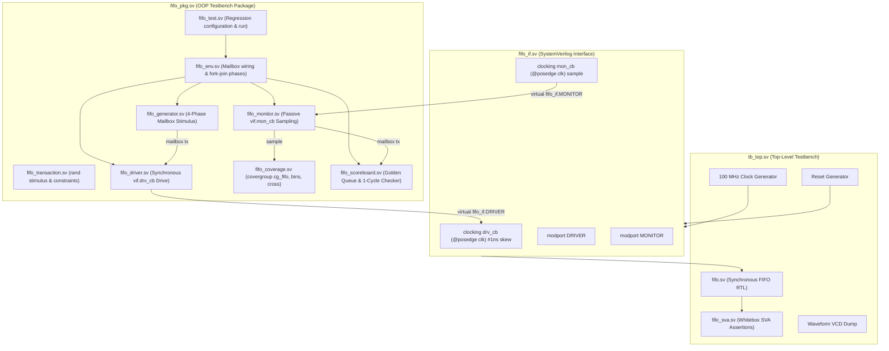

# ⚡ Autonomous VLSI Design Verification (DV) Platform
### *Pure SystemVerilog (IEEE 1800) Layered OOP Architecture & Autonomous AI Verification Agent*

[](https://standards.ieee.org/)
[](https://verilator.org/)
[](https://modelcontextprotocol.io/)
[](https://python.org/)
[](LICENSE)

> **Architect & Author:** **Sathvik Ande** ([sathvikande007@gmail.com](mailto:sathvikande007@gmail.com))  
> **GitHub:** [@sathvikande](https://github.com/sathvikande)

---

## 📌 Overview

The **Autonomous VLSI Design Verification Platform** is an enterprise-grade hardware verification environment combining:
1. **Pure SystemVerilog (IEEE 1800-2017) Layered OOP Testbench Suite**:
   Industry-standard modular testbench architecture (Interface with Clocking Blocks, Constrained-Random Transactions, Mailboxes, Driver, Passive Monitor, Dynamic Golden Queue Scoreboard, Native Covergroups, and Concurrent SVA Assertions).
2. **Autonomous AI Verification Agent (FastMCP Engine)**:
   Equips autonomous AI agents (Hermes, Claude, GPT, Antigravity) with **22 custom EDA tools** for closed-loop waveform debugging, formal temporal invariant proving, logic equivalence checking (LEC), and fault injection mutation testing.
3. **Turnkey Unified CLI (`vlsi`)**:
   Global terminal runner to scaffold new 12-file OOP testbenches in milliseconds, run multi-simulator regressions, grade test suites, and launch interactive signoff dashboards.

---

## 🏛️ IEEE 1800 Layered OOP Testbench Architecture



---

## 🏆 Commercial EDA Tool Equivalence

| Open-Source Tool in This Project | Commercial EDA Suite Equivalent | Capability & Purpose |
| :--- | :--- | :--- |
| **Verilator 5.0+ (`--binary --timing`)** | **Synopsys VCS / Cadence Xcelium** | Native compilation of SV OOP classes, mailboxes, and covergroups |
| **`vlsi_mcp.py` (FastMCP Server)** | **Cadence Verisium / Synopsys.ai** | 22 autonomous verification tools exposed to AI agents via stdio |
| **Yosys SAT Temporal Induction** | **Cadence JasperGold Formal** | Mathematical unbounded proof of SVA hardware properties |
| **Yosys Sequential Miter (`equiv`)** | **Cadence Conformal LEC / Formality** | 100% formal logic equivalence between golden & revised RTL |
| **Mutation Testing (`vlsi mutate`)** | **Cadence Verisium Fault / Certitude** | Injects synthetic hardware bugs to grade testbench bug resilience |
| **AMBA AXI4-Stream VIP (`cocotbext-axi`)** | **Cadence / Synopsys VIP Catalog** | Protocol compliance, backpressure, and packet framing verification |
| **Standalone HTML Dashboard** | **Cadence IMC / Synopsys Verdi Coverage** | Unified UCDB coverage signoff, vPlan audit, and assertion metrics |

---

## 🛠️ System Requirements & Prerequisites

- **Operating System**: macOS (Apple Silicon M1/M2/M3/M4 or Intel) or Linux (Ubuntu 20.04+, Debian 11+)
- **Python**: Python 3.10 to 3.14
- **Compilers**: C++20 compliant compiler (`clang++` on macOS via Xcode CLI Tools, or `g++-11+` on Linux)
- **Hardware Simulators**: Verilator 5.050+ and Icarus Verilog 13.0+
- **Formal Tools**: Yosys 0.30+ and Z3 SMT Solver 4.12+

---

## 🚀 Quick Installation

### Option 1: One-Click Automated Setup (Recommended)
Clone the repository and run the setup script:
```bash
git clone https://github.com/sathvikande/vlsi-dv-agent.git
cd vlsi-dv-agent
chmod +x setup.sh
./setup.sh
```

### Option 2: Manual Setup

#### macOS (via Homebrew):
```bash
brew install verilator icarus-verilog yosys z3 python@3.14
python3.14 -m pip install -r requirements.txt --break-system-packages || pip install -r requirements.txt
mkdir -p ~/.local/bin
ln -sf "$(pwd)/vlsi" ~/.local/bin/vlsi
export PATH="$HOME/.local/bin:$PATH"
```

#### Ubuntu / Debian Linux:
```bash
sudo apt-get update
sudo apt-get install -y verilator iverilog yosys z3 python3 python3-pip git make
pip3 install -r requirements.txt --break-system-packages || pip3 install -r requirements.txt
mkdir -p ~/.local/bin
ln -sf "$(pwd)/vlsi" ~/.local/bin/vlsi
export PATH="$HOME/.local/bin:$PATH"
```

---

## 💻 CLI Usage Guide (`vlsi`)

The unified `vlsi` command is available globally:

```bash
vlsi <command> [options]
```

### Essential Commands:

```bash
# 1. Run Pure SystemVerilog IEEE 1800 OOP Testbench
vlsi sv

# 2. Scaffold a brand-new 12-file SV OOP Testbench for any design (e.g. 'alu', 'uart')
vlsi gen-sv alu

# 3. Run the complete End-to-End Verification Pipeline
vlsi run

# 4. Run AMBA AXI4-Stream Protocol VIP Simulation
vlsi sim axis

# 5. Run Formal Logic Equivalence Checking (LEC)
vlsi lec

# 6. Run Automated Fault Injection & Mutation Testing
vlsi mutate

# 7. Generate and open interactive HTML Signoff Dashboard
vlsi dashboard

# 8. Launch Hermes AI Verification Engineer
vlsi agent

# 9. View Offline User Manual
vlsi manual

# 10. Auto-synchronize documentation after adding new tools
vlsi update-manual
```

---

## 📂 Project Structure

```
vlsi-dv-agent/
├── vlsi                    # Unified global CLI command wrapper
├── vlsi_mcp.py             # 22-Tool FastMCP Server for AI Agent Integration
├── USER_MANUAL.md          # Complete, auto-updating 20,000+ character manual
├── setup.sh                # One-click installation script for macOS & Linux
├── requirements.txt        # Python package dependencies
│
├── sv_fifo_tb/             # 100% Pure SystemVerilog Layered OOP Testbench
│   ├── fifo_if.sv          # SV Interface with skewed Clocking Blocks & Modports
│   ├── fifo_transaction.sv # Transaction class with rand stimulus & constraints
│   ├── fifo_coverage.sv    # Functional Covergroups, coverpoints, bins & cross
│   ├── fifo_generator.sv   # Mailbox generator (Fill, Drain, Simultaneous, Random)
│   ├── fifo_driver.sv      # Virtual interface driver with 5-cycle reset task
│   ├── fifo_monitor.sv     # Passive monitor sampling bus and triggering coverage
│   ├── fifo_scoreboard.sv  # Golden queue reference model & 1-cycle latency checker
│   ├── fifo_env.sv         # Environment orchestrating mailboxes & fork-join
│   ├── fifo_test.sv        # Base test configuring transactions and execution
│   ├── fifo_pkg.sv         # SystemVerilog package importing std::*
│   ├── tb_top.sv           # Top module with clock, DUT, SVA bind & VCD dump
│   └── Makefile            # Native Verilator 5 compilation target
│
├── demo_fifo/              # RTL, SVA Assertions, Formal & Mutation Testbed
│   ├── fifo.sv             # Synchronous FIFO RTL Design Under Test
│   ├── fifo_sva.sv         # Concurrent IEEE 1800 SystemVerilog Assertions
│   ├── axis_fifo.sv        # AMBA AXI4-Stream First-Word Fall-Through (FWFT) FIFO
│   ├── test_fifo.py        # Cocotb randomized testbench with guardrails
│   ├── test_axis_fifo.py   # Cocotb AXI VIP packet burst testbench
│   ├── vplan.yaml          # Machine-readable Verification Plan
│   └── Makefile            # Multi-simulator build script
│
└── context_backup/         # Complete audit trail & verbatim development history
```

---

## 🤖 Connecting to Autonomous AI Agents

This platform natively integrates with LLM agents via the **Model Context Protocol (MCP)**:

### Connecting with Hermes Agent:
Add to `~/.hermes/config.yaml`:
```yaml
mcp_servers:
  vlsi_tools:
    command: python3.14
    args:
      - /path/to/vlsi-dv-agent/vlsi_mcp.py  # or $HOME/vlsi-dv-agent/vlsi_mcp.py
```
Run `vlsi agent` to chat directly with your AI DV engineer:
> *"Inspect the FIFO specification, run the pure SystemVerilog testbench, prove the formal reset invariant, and generate the tapeout signoff dashboard."*

### Connecting with Claude Desktop:
Add to `~/Library/Application Support/Claude/claude_desktop_config.json`:
```json
{
  "mcpServers": {
    "vlsi_tools": {
      "command": "python3.14",
      "args": ["/path/to/vlsi-dv-agent/vlsi_mcp.py"]
    }
  }
}
```

---

## 📜 License

This project is licensed under the **MIT License** — free for academic, student, and commercial research use.

---

### 👨‍💻 Created by **Sathvik Ande**
For feedback, questions, or collaboration in Design Verification (DV) & EDA AI:
- **Email:** [sathvikande007@gmail.com](mailto:sathvikande007@gmail.com)
- **GitHub:** [@sathvikande](https://github.com/sathvikande)
